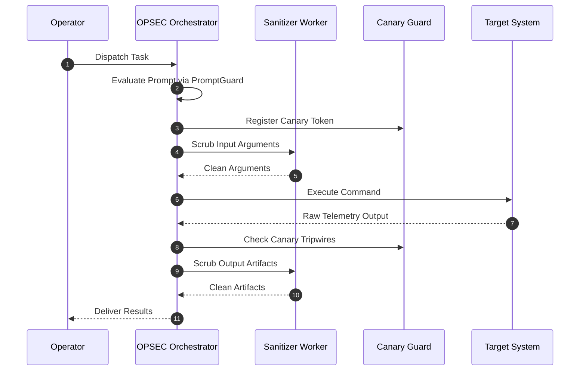

# Multi-Agent OPSEC Guidelines

## Operational Boundaries and Subagent Rules

---

### Scope

Rules for automated subagents executing tasks in this repository. These safeguards prevent prompt injection, data leaks, and credential exposure across multi-agent workflows.

---

### Subagent Rules

1. **Zero Emojis**: Keep all markdown outputs, generated logs, and comments clean of Unicode emojis.
2. **Centered Headings**: Wrap headings in `
\n\n... \n\n
`.
3. **Execution Isolation**:
   - Subagents must work strictly within their assigned project folder.
   - Do not make outbound network calls unless explicitly required by the task.
4. **Data Sanitization**:
   - Run `OpsecSanitizer` before writing logs or committing files containing raw telemetry.
   - Quarantine unexpected sensitive data immediately.
5. **Canary Trap Handling**:
   - Never print or leak canary tokens created by `CanaryManager`.
   - If a known canary token appears in an untrusted payload, stop the run and alert the user.

---

### Inspection Flow

---

### Pre-Push Checklist

- [ ] All markdown headings are centered using `
...
`.
- [ ] No emojis in any markdown, code comments, or commit messages.
- [ ] Unit tests pass: `python3 -m unittest tests/test_opsec.py`.
- [ ] Audit passes: `python3 scripts/audit_opsec.py`.
- [ ] Commit author is `stefanutc1 <321888485+stefanutc1@users.noreply.github.com>`.
