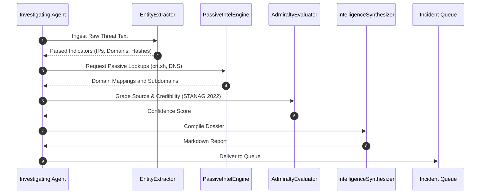

# Multi-Agent OSINT Guidelines

## Operational Boundaries and Subagent Rules

---

### Scope

Rules for automated subagents gathering and processing threat intelligence in this repository. These safeguards ensure all reconnaissance remains strictly passive and well-documented.

---

### Subagent Rules

1. **Zero Emojis**: Keep all markdown outputs, generated logs, and comments clean of Unicode emojis.
2. **Centered Headings**: Wrap headings in `
\n\n... \n\n
`.
3. **Passive Reconnaissance Only**:
   - Never run active port scanners (like Nmap), brute-force tools, or web application fuzzers against targets.
   - Limit data collection to public records, Certificate Transparency logs, and passive DNS caches.
4. **Admiralty Grading**:
   - Tag every threat indicator or external claim with a NATO STANAG 2022 Admiralty rating.
   - Treat single-source claims as unverified (E5 or F6) until corroborated by another source.
5. **Report Generation**:
   - Format final dossiers through `IntelligenceSynthesizer` and mark appropriate TLP headers (e.g. TLP:CLEAR or TLP:AMBER).

---

### Inspection Flow

---

### Pre-Push Checklist

- [ ] All markdown headings are centered using `
...
`.
- [ ] No emojis in any markdown, code comments, or commit messages.
- [ ] Unit tests pass: `python3 -m unittest tests/test_osint.py`.
- [ ] Audit passes: `python3 scripts/audit_osint.py`.
- [ ] Commit author is `stefanutc1 <321888485+stefanutc1@users.noreply.github.com>`.
