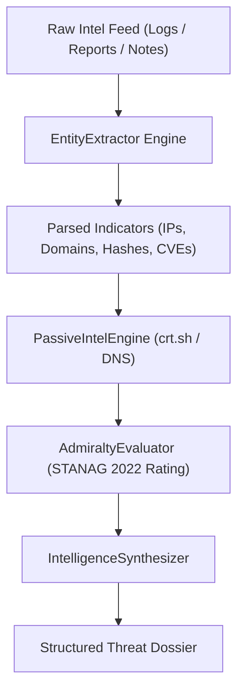

<div align="center">

# OSINT & Threat Intelligence Toolkit

</div>

<div align="center">

## Passive Reconnaissance, Indicator Extraction, and Admiralty Scoring

</div>

---

<div align="center">

### Overview

</div>

A lightweight toolkit for passive open-source intelligence and threat feed triage.

When investigating suspicious domains, phishing campaigns, or compromised infrastructure, analysts need quick ways to extract technical indicators, rate information credibility, and gather context without alerting threat actors.

This toolkit provides:

- **Indicator extraction (`lib/entity_extractor.py`)**: Pulls IPs, apex domains, FQDNs, hashes, CVEs, emails, and crypto wallet addresses out of unstructured text logs.
- **NATO Admiralty scoring (`lib/admiralty.py`)**: Evaluates source reliability (A to F) and information credibility (1 to 6) based on STANAG 2022 standards.
- **Passive reconnaissance (`lib/passive_intel.py`)**: Builds Certificate Transparency queries (crt.sh) and passive DNS profiles without running active port scans.
- **Dossier synthesis (`lib/synthesis.py`)**: Assembles extracted indicators, confidence scores, and analyst notes into structured reports.

---

<div align="center">

### NATO Admiralty (STANAG 2022) Matrix

</div>

| Source Reliability | Rating | Information Credibility | Rating |
| :--- | :--- | :--- | :--- |
| **Completely Reliable** | **A** | **Confirmed by Other Sources** | **1** |
| **Usually Reliable** | **B** | **Probably True** | **2** |
| **Fairly Reliable** | **C** | **Possibly True** | **3** |
| **Not Usually Reliable** | **D** | **Doubtful** | **4** |
| **Unreliable** | **E** | **Improbable** | **5** |
| **Cannot Be Judged** | **F** | **Truth Cannot Be Judged** | **6** |

---

<div align="center">

### Data Processing Flow

</div>



---

<div align="center">

### Repository Structure

</div>

```
cyber/osint/
├── AGENTS.md                  # Operating guidelines for subagents
├── CLAUDE.md                  # Guidelines and constraints for Claude
├── GEMINI.md                  # Guidelines and constraints for Gemini
├── README.md                  # Documentation and architecture guide
├── config/
│   ├── admiralty_matrix.json  # STANAG 2022 scoring definitions and weights
│   └── osint_sources.json     # Indicator regex patterns and source definitions
├── lib/
│   ├── __init__.py            # Package root
│   ├── admiralty.py           # Admiralty scoring and confidence calculation
│   ├── entity_extractor.py    # Regex-based indicator parser
│   ├── passive_intel.py       # Passive DNS and Certificate Transparency helpers
│   └── synthesis.py           # Markdown report compiler
├── scripts/
│   ├── audit_osint.py         # Format and compliance verification script
│   └── osint_cli.py           # CLI tool for parsing, scoring, and reconnaissance
└── tests/
    └── test_osint.py          # Unit tests
```

---

<div align="center">

### CLI Usage

</div>

The command-line tool (`osint_cli.py`) handles indicator extraction, source scoring, and report generation:

<div align="center">

#### 1. Extract Indicators of Compromise

</div>

```bash
# Extract indicators from a file
python3 scripts/osint_cli.py extract --file incident_raw_notes.txt

# Extract from standard input
cat threat_dump.log | python3 scripts/osint_cli.py extract
```

<div align="center">

#### 2. Calculate Admiralty Confidence

</div>

```bash
# Calculate confidence for a source rating
python3 scripts/osint_cli.py score --code B2
```

<div align="center">

#### 3. Profile Infrastructure Passively

</div>

```bash
# Generate Certificate Transparency lookup parameters
python3 scripts/osint_cli.py recon --target malicious-subdomain.adversary-infra.com
```

<div align="center">

#### 4. Compile a Threat Dossier

</div>

```bash
# Assemble a structured report from notes
python3 scripts/osint_cli.py synthesize \
  --title "Threat Actor Infrastructure Pivot" \
  --code B2 \
  --tlp TLP:AMBER \
  --file threat_intel_feed.txt
```

---

<div align="center">

### Tests and Verification

</div>

Run unit tests and verify markdown formatting:

```bash
# Run unit tests
python3 -m unittest tests/test_osint.py

# Run module compliance audit
python3 scripts/audit_osint.py
```
