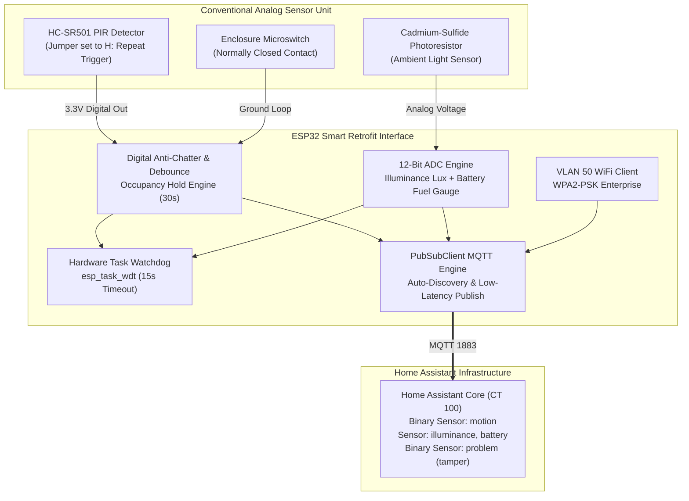

<div align="center">

# ESP32 Smart Motion Sensor Retrofit Appliance

</div>

**Platform**: ESP32-WROOM-32 / NodeMCU-32S  
**Firmware Architecture**: FreeRTOS Arduino Core with Hardware Watchdog Timer  
**Network Segment**: VLAN 50 (`192.168.50.0/24` - Isolated IoT Edge)  
**Central Telemetry Broker**: Mosquitto / Home Assistant (`192.168.20.10:1883`)  
**Target Retrofit Hardware**: Conventional Analog PIR Sensors (HC-SR501, SR602, AM312) or 230V PIR Detectors  

---

<div align="center">

## 1. Overview and Retrofit Concept

</div>

Conventional motion sensors (such as the ubiquitous HC-SR501 PIR sensor or standard wall-mounted 230V security PIR units) are purely "dumb" analog devices:
- They merely assert a digital 3.3V pulse or physically toggle an internal AC relay.
- They lack network connectivity, ambient light awareness in software, battery reporting, and tamper detection.
- Their hardware potentiometers drift with humidity and temperature, causing false triggers or premature shutoffs.

This project retrofits conventional dumb motion detectors into high-reliability, enterprise-grade IoT smart sensors by intercepting the analog/digital trigger output with an ESP32 microcontroller and augmenting it with:
1. **Software Debounce & Occupancy Hold Timing**: Completely replaces erratic analog delay circuits with a predictable 30-second digital keep-alive window.
2. **Ambient Light Sensing (LDR)**: Quantifies illuminance (lux), allowing Home Assistant to only activate lighting automations when darkness thresholds are met.
3. **Battery Fuel Gauge Monitoring**: Tracks cell voltage on 18650 Li-ion battery packs via a precision resistor divider.
4. **Enclosure Tamper Switch**: Detects unauthorized opening or physical removal of the sensor casing.
5. **Dual-Tech Sensor Fusion**: Optional microwave radar (RCWL-0516) input to eliminate PIR blind spots through glass and light obstacles.

<div align="center">

### Conversion Architecture Diagram

</div>



---

<div align="center">

## 2. Hardware Retrofitting and Modification Steps

</div>

### Step 1: Configuring the Conventional PIR Module (HC-SR501)
1. **Jumper Configuration**: Move the yellow jumper on the HC-SR501 to the **H position (Repeat Trigger)**. This ensures that as long as continuous motion is present, the output pin stays HIGH, allowing the ESP32 software to manage debouncing and occupancy hold accurately.
2. **Time Delay Potentiometer**: Turn the time-delay potentiometer fully counter-clockwise to the minimum setting (~2.5 to 3 seconds). We offload all delay timing to the ESP32 C++ state machine.
3. **Sensitivity Potentiometer**: Set to midway (~5 meters detection cone).

### Step 2: Power and Level Shifting
- The HC-SR501 features an onboard 7133 3.3V low-dropout voltage regulator. Power the sensor's `VCC` pin from the ESP32 `VIN` pin (5V USB rail) or directly tap into the 3.3V rail if bypassing the regulator.
- The `OUT` pin outputs 3.3V logic levels, perfectly safe to connect directly to ESP32 GPIO inputs without level shifters.

### Step 3: Battery Monitoring Divider
To safely measure an 18650 Li-ion cell (voltage ranging from 3.2V to 4.2V) using the ESP32 ADC (maximum safe input voltage 3.3V):
- Connect two 100k Ohm 1% precision metal film resistors in series between `BAT+` and `GND`.
- Connect the midpoint between the two resistors to `GPIO 35` (ADC1 Channel 7).
- Division ratio: $V_{\text{pin}} = V_{\text{battery}} \times \frac{100\text{k}}{100\text{k} + 100\text{k}} = 0.5 \times V_{\text{battery}}$ (Maximum 2.1V at full 4.2V charge, well within the safe linear range).

---

<div align="center">

## 3. Hardware Pinout and Wiring Specifications

</div>

| ESP32 Pin | Peripheral Connection | Function | Electrical Specification | Safety / Protection |
| :--- | :--- | :--- | :--- | :--- |
| `GPIO 13` | PIR Module Output | Motion Detection Trigger | Digital Input (3.3V CMOS) | Debounced in Software (150ms) |
| `GPIO 27` | RCWL-0516 Radar Out | Microwave Motion Detection | Digital Input (3.3V CMOS) | Optional Dual-Tech Verification |
| `GPIO 34` | LDR Voltage Divider | Ambient Illuminance Sensor | Analog Input (ADC1_CH6) | Safe during active WiFi operations |
| `GPIO 35` | Battery Voltage Divider | 18650 Cell Voltage Sensing | Analog Input (ADC1_CH7) | 100k / 100k Resistor Divider |
| `GPIO 14` | Tamper Microswitch | Enclosure Physical Security | Digital Input (Pull-Up) | Active LOW when casing is closed |
| `GPIO 2` | Onboard LED | Motion / Heartbeat Indicator | Active HIGH Output | Visual feedback for walk-testing |

---

<div align="center">

## 4. MQTT Telemetry and Home Assistant Integration

</div>

### Published JSON State Payload

On motion trigger or 60-second periodic heartbeat, the sensor publishes to `homelab/sensors/motion/state`:

```json
{
  "occupancy": "ON",
  "tamper": "OFF",
  "illuminance_lux": 142.5,
  "battery_voltage": 3.98,
  "battery_percent": 78,
  "uptime_sec": 3600
}
```

### Auto-Discovered Home Assistant Entities

The firmware registers four distinct entities under device `ESP32 Smart Motion Sensor`:
1. `binary_sensor.smart_motion_occupancy`: Real-time room presence indicator (`device_class: motion`).
2. `binary_sensor.smart_motion_tamper`: Enclosure opening alert (`device_class: problem`).
3. `sensor.smart_motion_illuminance`: Ambient room brightness (`device_class: illuminance`, unit `lx`).
4. `sensor.smart_motion_battery`: Remaining cell charge (`device_class: battery`, unit `%`).

---

<div align="center">

## 5. Build and Flashing Instructions

</div>

```bash
# 1. Compile sketch using Arduino CLI
arduino-cli compile --fqbn esp32:esp32:esp32 smart_motion_sensor.ino

# 2. Upload over USB serial interface
arduino-cli upload -p /dev/ttyUSB0 --fqbn esp32:esp32:esp32 smart_motion_sensor.ino

# 3. Monitor Serial Output (115200 baud)
arduino-cli monitor -p /dev/ttyUSB0 -c baudrate=115200
```
