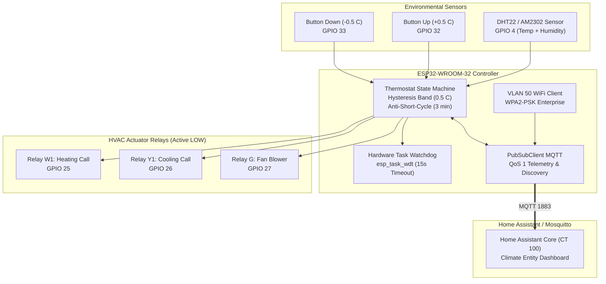

<div align="center">

# ESP32 Smart HVAC Thermostat Controller

</div>

**Platform**: ESP32-WROOM-32 / NodeMCU-32S  
**Firmware Architecture**: FreeRTOS Arduino Core with Hardware Watchdog Timer  
**Network Segment**: VLAN 50 (`192.168.50.0/24` - Isolated IoT Edge)  
**Central Telemetry Broker**: Mosquitto / Home Assistant (`192.168.20.10:1883`)  
**Protocol Integration**: MQTT Climate Entity with Native Home Assistant Auto-Discovery  

---

<div align="center">

## 1. Overview and Operational Logic

</div>

The ESP32 Smart HVAC Thermostat Controller provides precision thermal regulation for homelab server racks, laboratory environments, and residential climate zones. It interfaces with standard 24VAC HVAC systems or low-voltage heating/cooling circuits through optocoupled relay isolation.

<div align="center">

### Control Architecture Diagram

</div>



---

<div align="center">

## 2. Hardware Pinout and Wiring Specifications

</div>

| ESP32 Pin | Peripheral Connection | Function | Electrical Specification | Safety Isolation |
| :--- | :--- | :--- | :--- | :--- |
| `GPIO 4` | DHT22 / AM2302 (Data) | Temperature and Humidity Sensor | 3.3V Data with 4.7k Pull-up | Direct CMOS |
| `GPIO 25` | Relay 1 (IN1) | Call for Heat (HVAC W1) | Active LOW (0V activates relay) | 2.5kV Optocoupler |
| `GPIO 26` | Relay 2 (IN2) | Call for Cool (HVAC Y1) | Active LOW (0V activates relay) | 2.5kV Optocoupler |
| `GPIO 27` | Relay 3 (IN3) | Blower Fan (HVAC G) | Active LOW (0V activates relay) | 2.5kV Optocoupler |
| `GPIO 32` | Tactile Button 1 | Manual Setpoint Increment (+0.5 C) | Internal Pull-Up to GND | Debounced in Software |
| `GPIO 33` | Tactile Button 2 | Manual Setpoint Decrement (-0.5 C) | Internal Pull-Up to GND | Debounced in Software |
| `GPIO 2` | Onboard LED | Status and WiFi Heartbeat | Active HIGH (Blue LED) | Current-limited resistor |
| `GPIO 21` | SSD1306 OLED (SDA) | Optional Local Display Data | I2C Bus (3.3V) | Open Drain Pull-up |
| `GPIO 22` | SSD1306 OLED (SCL) | Optional Local Display Clock | I2C Bus (3.3V) | Open Drain Pull-up |

---

<div align="center">

## 3. HVAC Safety and Protection Mechanisms

</div>

1. **Hardware Mutual Exclusion Interlock**:
   The controller strictly forbids simultaneous activation of heating (W1) and cooling (Y1) relays. If both calls are asserted by mistake, cooling is instantly suppressed.
2. **Anti-Short-Cycle Compressor Guard**:
   Air conditioning compressors and high-efficiency furnaces are vulnerable to rapid cycling. A mandatory 180-second (3-minute) delay is enforced between state transitions to equalize refrigerant pressure.
3. **Sensor Disconnect Auto-Cutoff**:
   If the temperature reading returns `NaN` or fails to update within 60 seconds, the thermostat triggers an emergency shutdown, cutting all relays to prevent runaway heating or freezing.
4. **Hardware Watchdog Timer (`esp_task_wdt`)**:
   Monitors execution of the main task. If the WiFi stack or MQTT loop blocks for more than 15 seconds, the ESP32 performs an automated warm reboot into a failsafe state.

---

<div align="center">

## 4. MQTT Topics and Home Assistant Auto-Discovery

</div>

### MQTT Topic Hierarchy

```text
homelab/climate/thermostat/state          # JSON payload with current temp, target, mode, action
homelab/climate/thermostat/set_target     # Setpoint command topic (e.g., "21.5")
homelab/climate/thermostat/set_mode       # Mode command topic ("off", "heat", "cool", "auto")
homelab/climate/thermostat/telemetry     # Heartbeat telemetry for logging and time-series DB
homelab/devices/thermostat/status         # LWT status ("online" / "offline")
```

### Home Assistant MQTT Climate Discovery Payload

The controller automatically publishes configuration to:  
`homeassistant/climate/smart_thermostat/config`

```json
{
  "name": "Datacenter Smart Thermostat",
  "unique_id": "esp32_smart_thermostat_01",
  "modes": ["off", "heat", "cool", "auto"],
  "mode_state_topic": "homelab/climate/thermostat/state",
  "mode_state_template": "{{ value_json.mode }}",
  "mode_command_topic": "homelab/climate/thermostat/set_mode",
  "current_temperature_topic": "homelab/climate/thermostat/state",
  "current_temperature_template": "{{ value_json.current_temperature }}",
  "temperature_state_topic": "homelab/climate/thermostat/state",
  "temperature_state_template": "{{ value_json.target_temperature }}",
  "temperature_command_topic": "homelab/climate/thermostat/set_target",
  "temp_step": 0.5,
  "min_temp": 15.0,
  "max_temp": 30.0,
  "action_topic": "homelab/climate/thermostat/state",
  "action_template": "{{ value_json.action }}",
  "device": {
    "identifiers": ["esp32_smart_thermostat"],
    "name": "ESP32 Smart Thermostat",
    "model": "ESP32-WROOM-32",
    "manufacturer": "Homelab Physical Computing"
  }
}
```

---

<div align="center">

## 5. Build and Flashing Instructions

</div>

```bash
# 1. Compile using Arduino CLI
arduino-cli compile --fqbn esp32:esp32:esp32 smart_thermostat.ino

# 2. Upload to ESP32 over USB UART
arduino-cli upload -p /dev/ttyUSB0 --fqbn esp32:esp32:esp32 smart_thermostat.ino

# 3. Monitor Serial Console (115200 baud)
arduino-cli monitor -p /dev/ttyUSB0 -c baudrate=115200
```
